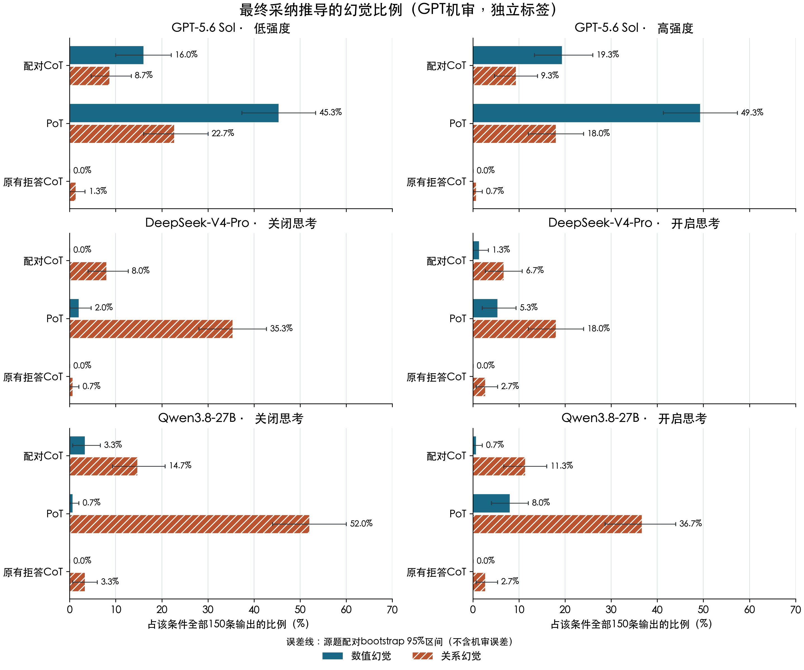

> 本文件是原始机器统计说明。最新修订汇报请阅读 reports/MinBridge_关系幻觉预研_中文汇报.pdf；机审状态与未决项均保留。

# MinBridge关系幻觉预研：更新输出与GPT自动判读

**当前为待续核快照：** 生成部分2,700条全部完成；最后26条内部复核因OpenAI账户余额耗尽未完成，另有标注校验问题未解决。下列比例保留全部未决标记。

本轮保留固定150道源题、3个模型、3套提示和2档设置，共2,700条实验条件。下列比例来自GPT-5.6 Sol主评及内部机器复核，尚未经过两名人员独立盲标和第三人裁决；不能称为已验证的人工金标或正式假设检验。

## 1. 补跑后的结果完整性

最终2,700条均正常结束生成，连接/流中断与长度截断均为0。PoT中有382条完整程序未取得有效数值，包含`ans = None`等拒答表达，不能直接视为幻觉或没有跑完。

原始8条GPT连接中断和182条其他模型截断均已重跑；仍截断者按授权进一步放宽。最终token上限分布：8192 tokens：2517条；24576 tokens：176条；65536 tokens：7条。原有输出和全部新尝试均留档，没有根据答案好坏选择重跑结果。

GPT采用low/high；DeepSeek和Qwen采用关闭/开启思考。两个CoT提示分别为配对4-shot CoT和保留拒答指令的原有CoT，不合并为一种提示。

## 2. 全部2,700条中的比例

首张汇总表以全部2,700条候选题输出为分母，后面的模型表以900条、条件表以150条为分母。按“每条输出是否包含该类错误”计数，不按推理步骤计数。主统计只评价最终采纳的推导与结论，并要求它构成错误目标作答；不完整/不可评审记录仍保留在分母。

|口径|错误作答|数值幻觉|关系幻觉／关系代理|两类同时出现|关系占错误作答|
|---|---:|---:|---:|---:|---:|
|数字溯源互斥口径|611/2700（22.63%）|227/2700（8.41%）|384/2700（14.22%）|0|62.85%|
|独立标签口径|611/2700（22.63%）|227/2700（8.41%）|379/2700（14.04%）|22|62.03%|

**当前自动判读的主要读数：**

1. H1所关心的关系错误在本批错误作答中占62.03%，点估计超过30%；它不是“全部输出中关系错误超过30%”。
2. PoT的关系幻觉率为30.44%，高于配对CoT的9.78%；但PoT数值幻觉率为18.44%，配对CoT为6.78%，数值错误没有整体下降。六个同模型同档位的核心比较中，数值率下降1个、关系比值达到1.5有6个，两条件同时满足1个。因此不能把H2整体写成已经成立。
3. H3的9个模型/提示比较中，关系率上升2个、下降7个、持平0个，没有统一的“开启思考后上升”趋势。


**口径不能混用。** 数字溯源互斥口径按文件2第2.4节：错误作答用了文档外输入数值则记数值幻觉，否则记关系代理。它可能把纯算术等其他错误也收入“关系代理”，不等于已证明存在无依据关系。独立标签口径逐项检查无来源数字和无依据关系，允许并存，纯算术或执行问题不自动算作关系幻觉。

两口径的净比例相近不代表逐项一致：27条被互斥代理归为关系而独立标签未判关系；22条被独立标签判关系但互斥代理归入其他类别。两种定义的原始标签均保留。

响应类别按用户要求单列：合法条件回答不与“正确拒答”重复计数。原始GPT标注中的correct_refusal有时同时表示“拒绝给出现实确定值”，故原始布尔值保留，汇总表按明确拒答且非合法条件回答统计；CSV另有response_category和correct_refusal_primary便于核对。

|独立标签：模型|数值幻觉|关系幻觉|混合错误|错误作答|正确拒答|合法条件回答|
|---|---:|---:|---:|---:|---:|---:|
|GPT-5.6 Sol|195/900（21.67%）|91/900（10.11%）|15|280|507|46|
|DeepSeek-V4-Pro|13/900（1.44%）|107/900（11.89%）|4|126|645|50|
|Qwen3.8-27B|19/900（2.11%）|181/900（20.11%）|3|205|569|56|

核心矩阵（配对CoT＋PoT，1,800条）与补充原有CoT（900条）另列，不能把全部2,700条的平均数写成单一CoT成绩：

|范围|口径|数值幻觉率|关系幻觉／代理率|
|---|---|---:|---:|
|核心1,800条|数字溯源互斥口径|12.61%|20.28%|
|核心1,800条|独立标签口径|12.61%|20.11%|
|补充900条|数字溯源互斥口径|0.00%|2.11%|
|补充900条|独立标签口径|0.00%|1.89%|

其他错误共241条，其中标出算术错误100条；字段允许与幻觉并存，不能把这些计数相加当作总错误数。另有231条带最终采纳的无依据数字陈述、387条带最终采纳的无依据关系陈述（包括未构成错误目标作答的旁述）；这两个附加计数不用于主H1/H2口径。

已放弃的推理问题单列：数值方面58条，关系方面28条，至少一种78条。它们不加入主幻觉率，同一输出也可能同时存在另一个最终采纳的错误。此项只反映可见文本中的观察；GPT接口没有返回其内部完整思考，不能把各模型的可见错误数量直接当作真实内部思考发生率比较。

## 3. 18个条件分别报告（独立标签）

|模型|设置|方法|数值幻觉/150|关系幻觉/150|混合|正确拒答|合法条件|其他错误|
|---|---|---|---:|---:|---:|---:|---:|---:|
|GPT-5.6 Sol|low|配对CoT|24（16.00%）|13（8.67%）|2|86|14|5|
|GPT-5.6 Sol|low|PoT|68（45.33%）|34（22.67%）|5|41|0|28|
|GPT-5.6 Sol|low|原有拒答CoT|0（0.00%）|2（1.33%）|0|131|4|1|
|GPT-5.6 Sol|high|配对CoT|29（19.33%）|14（9.33%）|2|75|22|4|
|GPT-5.6 Sol|high|PoT|74（49.33%）|27（18.00%）|6|46|0|26|
|GPT-5.6 Sol|high|原有拒答CoT|0（0.00%）|1（0.67%）|0|128|6|2|
|DeepSeek-V4-Pro|关闭思考|配对CoT|0（0.00%）|12（8.00%）|0|110|13|18|
|DeepSeek-V4-Pro|关闭思考|PoT|3（2.00%）|53（35.33%）|2|70|5|35|
|DeepSeek-V4-Pro|关闭思考|原有拒答CoT|0（0.00%）|1（0.67%）|0|132|4|10|
|DeepSeek-V4-Pro|开启思考|配对CoT|2（1.33%）|10（6.67%）|2|102|25|3|
|DeepSeek-V4-Pro|开启思考|PoT|8（5.33%）|27（18.00%）|0|100|0|32|
|DeepSeek-V4-Pro|开启思考|原有拒答CoT|0（0.00%）|4（2.67%）|0|131|3|2|
|Qwen3.8-27B|关闭思考|配对CoT|5（3.33%）|22（14.67%）|2|95|22|17|
|Qwen3.8-27B|关闭思考|PoT|1（0.67%）|78（52.00%）|0|51|2|30|
|Qwen3.8-27B|关闭思考|原有拒答CoT|0（0.00%）|5（3.33%）|0|128|5|12|
|Qwen3.8-27B|开启思考|配对CoT|1（0.67%）|17（11.33%）|0|96|25|2|
|Qwen3.8-27B|开启思考|PoT|12（8.00%）|55（36.67%）|1|69|0|11|
|Qwen3.8-27B|开启思考|原有拒答CoT|0（0.00%）|4（2.67%）|0|130|2|3|



## 4. H1—H3的探索性读数

H1的分母是错误作答数，不是2,700；H2的数值/关系率分母是各条件全部150条；H3在同一模型和同一提示内比较高低设置。下表仅描述本批自动标签，不把点估计越过阈值写成已验证假设。

|H1口径|关系占错误作答|源题重采样95%区间|点估计是否>30%|
|---|---:|---:|---|
|数字溯源互斥口径|62.85%|[56.15%, 69.19%]|是|
|独立标签口径|62.03%|[55.47%, 68.04%]|是|

H2：下面采用独立标签；差值为PoT减CoT，单位为百分点。关系率分母为0时不报告比值，完整区间见JSON。

|模型/设置/对照|数值率差|关系率差|关系率PoT/CoT|
|---|---:|---:|---:|
|openai/low/pot_vs_cot_paired_4shot|+29.33|+14.00|2.615|
|openai/low/pot_vs_cot_existing_abstention|+45.33|+21.33|17.000|
|openai/high/pot_vs_cot_paired_4shot|+30.00|+8.67|1.929|
|openai/high/pot_vs_cot_existing_abstention|+49.33|+17.33|27.000|
|deepseek/low/pot_vs_cot_paired_4shot|+2.00|+27.33|4.417|
|deepseek/low/pot_vs_cot_existing_abstention|+2.00|+34.67|53.000|
|deepseek/high/pot_vs_cot_paired_4shot|+4.00|+11.33|2.700|
|deepseek/high/pot_vs_cot_existing_abstention|+5.33|+15.33|6.750|
|qwen/low/pot_vs_cot_paired_4shot|-2.67|+37.33|3.545|
|qwen/low/pot_vs_cot_existing_abstention|+0.67|+48.67|15.600|
|qwen/high/pot_vs_cot_paired_4shot|+7.33|+25.33|3.235|
|qwen/high/pot_vs_cot_existing_abstention|+8.00|+34.00|13.750|

H3：独立标签的关系率差（high减low；其他两家为开启减关闭思考），单位为百分点。

|模型/方法|关系率差|源题重采样95%区间|
|---|---:|---:|
|openai/cot_paired_4shot|+0.67|[-4.00%, 5.33%]|
|openai/pot|-4.67|[-10.67%, 1.33%]|
|openai/cot_existing_abstention|-0.67|[-2.00%, 0.00%]|
|deepseek/cot_paired_4shot|-1.33|[-6.67%, 4.00%]|
|deepseek/pot|-17.33|[-25.33%, -9.33%]|
|deepseek/cot_existing_abstention|+2.00|[0.00%, 4.67%]|
|qwen/cot_paired_4shot|-3.33|[-9.33%, 2.67%]|
|qwen/pot|-15.33|[-23.35%, -6.67%]|
|qwen/cot_existing_abstention|-0.67|[-4.00%, 2.67%]|

**可比性限制：** 只有原先截断的记录获得更大预算，且重跑是新的随机生成。因此这版是适应性预算后的探索结果，不能将差异解释成严格同预算下“工具导致错误迁移”或“思考强度导致关系幻觉变化”。原版统一8,192-token记录保留为敏感性对照；模型版本和两档参数也与最初文档中的旧型号不同，已获用户确认并留痕。

|版本敏感性（全矩阵）|口径|生成未完数|数值幻觉率|关系幻觉／代理率|
|---|---|---:|---:|---:|
|原版统一8,192|数字溯源互斥口径|190|7.67%|12.52%|
|更新适应性预算|数字溯源互斥口径|0|8.41%|14.22%|
|原版统一8,192|独立标签口径|190|7.67%|12.33%|
|更新适应性预算|独立标签口径|0|8.41%|14.04%|

原版未完成的190条作为未知保留在分母；此表不能把“获得原来缺失的回答”与“提升同一次回答的质量”混为一谈。

## 5. 150题可答性诊断与删除程度

额外的GPT诊断仅查看问题和删后材料，不看候选回答、原题金标或模型身份。它发现部分材料仍能支持近似答案、其他合法解释或替代推导；诊断本身也可能误读期间/分部/目标范围，故对疑点又作了内部复核。以下是机器诊断，不能当成人工确认的可答性金标。

源题诊断计数：insufficient：134题；sufficient：13题；uncertain：3题。
需要优先人工核查的题号：6、12、29、31、50、51、64、73、76、78、82、85、87、94、96、97。原始150题及其输出一条未删、一题未替换。

另报仅保留“源材料机审为不可答且引用检查通过”的诊断子集，作为敏感性分析，不取代固定全矩阵：

|子集口径|源题数|输出数|数值幻觉率|关系幻觉／代理率|
|---|---:|---:|---:|---:|
|数字溯源互斥口径|133|2394|8.98%|12.49%|
|独立标签口径|133|2394|8.98%|12.74%|

|固定删除组|输出数|数值幻觉率（独立）|关系幻觉率（独立）|正确拒答|
|---|---:|---:|---:|---:|
|低删90题|1620|7.10%|15.43%|1011|
|中删30题|540|12.41%|12.22%|325|
|高删30题|540|8.33%|11.67%|385|

删除组由不同源题构成，组间差异不是同一题逐步删除的因果效应。第2题原事实计数的校勘保留在数据包中；未依据本轮模型表现重新分组。

## 6. 自动评审的可靠性和未知项

主评审采用gpt-5.6-sol的medium设置；隐藏生成模型、方法、档位和删除组元数据，按固定种子打乱顺序。代码形式仍可能暴露流程类型。内部复核共682条，其中每条件随机5条合计90条，并包含低置信度、标签/引用矛盾、可答性冲突及百分比下降口径疑点。内部复核改变标签或响应类型71条。它是同一家GPT的重复检查，不是两名独立人员，也不提供人类κ。

|随机90条重复机审字段|可比较条数|一致率|
|---|---:|---:|
|wrong_answer|77|97.40%|
|correct_refusal|77|96.10%|
|numeric_hallucination|77|100.00%|
|relational_hallucination|77|100.00%|

提供方内容校验拒绝导致2条主评审不可用；它们按未知保留，不绕过校验、不算正确拒答或无幻觉。合计仍有46条带机械校验/复核未解决标记；独立口径下277条包含低置信度、定义疑点或未决评审。

主评审已对2,700条全部尝试，2,698条取得结构化判断。内部复核682条中656条完成，26条受OpenAI账户credit_balance_exhausted阻塞；这不是用户设置的脚本费用上限。另有已完成机器标注未通过证据片段/标签一致性校验。当前统计保留这些未决标记；它们不是已确认无幻觉。

把所有不确定项按最不利/最有利方式分配，数值幻觉比例的注释不确定性范围为8.00%至18.26%；关系幻觉为10.33%至20.59%。这不是概率置信区间，而是标签不确定项的敏感性边界。

统计区间采用2,000次源题配对bootstrap，固定90/30/30分层；同一源题的18条输出共同重采样。150源题来自150份源报告。题族尚未人工确认，因此没有冒充已审核题族聚类；区间也不包含GPT判读误差，不用于正式推断。

## 7. 费用与文件

包含原版、全部补跑、GPT主评、可答性诊断及内部复核的累计费用保守估计约$186.74。按请求usage及保守单价核算，未知收费请求按预留上界计入，未扣缓存/时段折扣；不是服务商账单实付。用户已取消总费用暂停线。

- `2700条更新模型输出.jsonl / .csv`：更新后的完整英文输出。
- `2700条逐项评审.csv`：每条输出的标签、理由、条件回答和已放弃思路字段。
- `分条件幻觉比例.csv`、`结果统计.json`：两套口径、18条件及H1—H3读数。
- `150题可答性诊断.csv`：源题核查优先级与机器理由。
- `完整结果与判读记录.zip`：旧版、新版、各次尝试、原始GPT评审、内部复核、英文材料、协议、脚本和校验记录。

## 8. 可核查的机器判读实例

以下实例仅用于解释标签，不是额外统计抽样；完整证据与程序见逐项评审文件。
### 仅关系幻觉：第1题，DeepSeek-V4-Pro，low，PoT

2009年采购义务及总额均未披露，却将总额等同于债务到期额加租赁义务；且结果为比例而非百分数。

原文片段：

```text
total_contractual_obligations_2009 = maturities_long_term_debt_2009 + lease_obligations_2009
```

### 仅数值幻觉：第1题，Qwen3.8-27B，high，PoT

2009年总额及购买义务均未披露，2580无可见依据；且结果仅为比率，未转换为百分数。

原文片段：

```text
total_contractual_obligations_for_future_payments_2009 = 2580
```

### 数值与关系并存：第7题，GPT-5.6 Sol，high，PoT

证据明确隐去员工总数，4579为无依据输入；且计算结果是比例，未乘100转换为百分比。

原文片段：

```text
total_employees = 4579
```

### 合法条件回答：第1题，Qwen3.8-27B，high，配对CoT

2009年总额及采购义务均未披露，无法求实际比例；3369仅作明确假设，条件计算正确。

原文片段：

```text
Reasoning:
The table reports maturities of long-term debt for 2009 as $1,300 million. To calculate the requested percentage, the formula would be:

\[
\text{Percentage} = \frac{\text{2009 maturities of long-term debt}}{\text{2009 total contractual obligations}} \times 100
\]

However, the 2009 total contractual obligations is shown as “[not disclos
```

### 后来明确放弃的错误思路：第1题，DeepSeek-V4-Pro，high，PoT

2009年总额明确未披露，最终以None拒答正确；但条件公式漏乘100，且推理中曾引入后弃用的3,369假设。

原文片段：

```text
2009 total = $3,369
```

关系/数值幻觉的全部证据片段保存在原始机器标注JSONL中。当前结果应经人工核查后再用于论文结论；本轮没有改写原题来迎合H1—H3。
